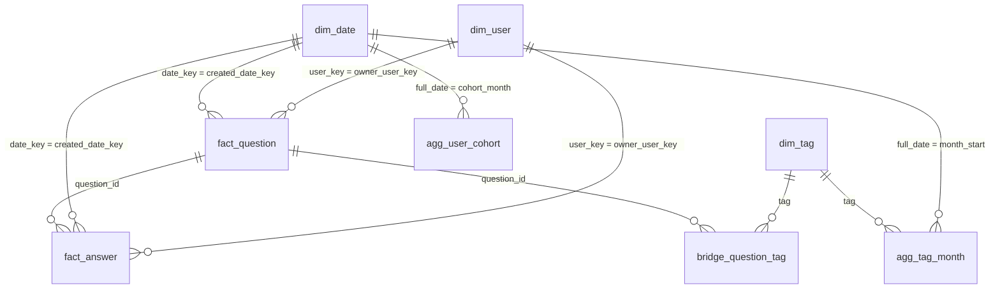

# Gold model

The Gold layer is a star schema built from the current Silver tables. It is the model the dashboard queries. Column types and comments are generated into the [data dictionary](data_dictionary.md) from `src/so_lakehouse/schemas.py`. This page is the relationship and metric contract.

Deleted questions, and the answers on those questions, are excluded. A later incremental load that marks a question deleted removes it from Gold on the next refresh (`WHEN NOT MATCHED BY SOURCE THEN DELETE`).

## Relationships

| From | Column | To | Column | Notes |
|---|---|---|---|---|
| `fact_question` | `created_date_key` | `dim_date` | `date_key` | Day the question was asked |
| `fact_question` | `owner_user_key` | `dim_user` | `user_key` | Null when the owner account no longer has an id |
| `fact_answer` | `question_id` | `fact_question` | `question_id` | |
| `fact_answer` | `created_date_key` | `dim_date` | `date_key` | Day the answer was posted |
| `fact_answer` | `owner_user_key` | `dim_user` | `user_key` | Nullable |
| `bridge_question_tag` | `question_id` | `fact_question` | `question_id` | Many tags per question |
| `bridge_question_tag` | `tag` | `dim_tag` | `tag` | |
| `agg_tag_month` | `tag` | `dim_tag` | `tag` | Tracked tags only |
| `agg_tag_month` | `month_start` | `dim_date` | `full_date` | Always the first day of a month |
| `agg_user_cohort` | `cohort_month` | `dim_date` | `full_date` | Always the first day of a month |

`dim_date.date_key` is an integer `YYYYMMDD`. `is_after_chatgpt` is true on and after 30 November 2022. The calendar always includes November 2022, so the launch day is present even when the loaded questions start later.

`dim_tag.category` is one of: DataFrame and query engines, Big data, Machine learning, Visualisation and BI, Data platforms and orchestration, Languages. A tag that arrived on a question but is not one of the 18 collected tags is category `Other`.

`dim_user.user_key` is the same salted hash Silver stores. Reputation is banded as `under 100`, `100 to 999`, `1,000 to 9,999`, `10,000 or more`, or `unknown`.

## How the business questions use the tables

1. **Did Q&A decline after late 2022, and which technologies were hit hardest?** `agg_tag_month` joined to `dim_tag`, plotted by `year_month`, split by `category`. `dim_date.is_after_chatgpt` marks the launch.
2. **Where do people wait longest, and which tags are under-served?** `agg_tag_month.median_hours_to_first_answer`, `p90_hours_to_first_answer` and `pct_unanswered`.
3. **Which technologies are gaining or losing share?** `agg_tag_month.share_of_tracked_questions` over `year_month`.

`agg_tag_pairs` is the co-occurrence chart. `agg_user_cohort` is the retention chart. `fact_question` and `fact_answer` are there when a visual needs one row per post rather than a monthly rollup.

## Metric definitions

All of these ignore deleted questions and deleted answers.

| Metric | Definition |
|---|---|
| `hours_to_first_answer` | Hours from `created_at` to the earliest surviving answer. Null when nobody answered. |
| `hours_to_accepted_answer` | Hours from `created_at` to the earliest answer with `is_accepted`. |
| `answered_within_24h` | `hours_to_first_answer` is 24 or less. Never-answered questions are false. |
| `is_first_answer` | Exactly one answer per question: the earliest `created_at`, then the smaller `answer_id`. |
| `questions` | Distinct non-deleted questions created that month carrying that tag. |
| `answers` | Surviving answers on questions created that month with that tag. |
| `share_of_tracked_questions` | `questions` for this tag, divided by the distinct tracked questions that month, times 100. A question with two tracked tags is counted in each tag, but only once in the denominator, so the shares can sum to more than 100. |
| `pct_unanswered` | Percent of this tag's questions with no surviving answer. |
| `median_hours_to_first_answer`, `p90_hours_to_first_answer` | `percentile_approx` of `hours_to_first_answer`. Unanswered questions are left out, because a median cannot include "never". |
| `pct_closed` | Percent of this tag's questions with `is_closed`. |
| `pct_answered_within_24h` | Percent of this tag's questions answered within 24 hours. Unanswered questions count against this percent. |
| `question_count` on `agg_tag_pairs` | Questions carrying both tracked tags. `tag_a` is alphabetically before `tag_b`, so each pair appears once. |
| `share_still_active` | Of users whose first non-deleted post was in `cohort_month`, the fraction who posted a question or answer `months_since` months later. Month 0 is 1. |

## Refresh and performance

`run_silver_to_gold` reads current Silver, builds each result, and runs `MERGE INTO`. A matched row is updated only when `record_hash` changed. `load_timestamp` is not part of that hash, so an unchanged row keeps its old timestamp. Rows that are no longer produced are deleted.

After the merges, the step compacts the tables the dashboard filters:

- Databricks: `ALTER TABLE ... CLUSTER BY` on `created_date_key` (facts), `tag` (bridge) or `month_start` (monthly aggregate), then `OPTIMIZE`.
- Local Spark: `OPTIMIZE ... ZORDER BY` the same columns. Open-source Delta has no liquid clustering.

Every table write, and the optimize step, appends a row to `so_ops.pipeline_execution_logs` with layer `Silver-to-Gold`, start and end time, status, and rows read, inserted, updated and deleted. The message on `fact_question` records how many Silver questions were aggregated and how many deleted questions were excluded.
