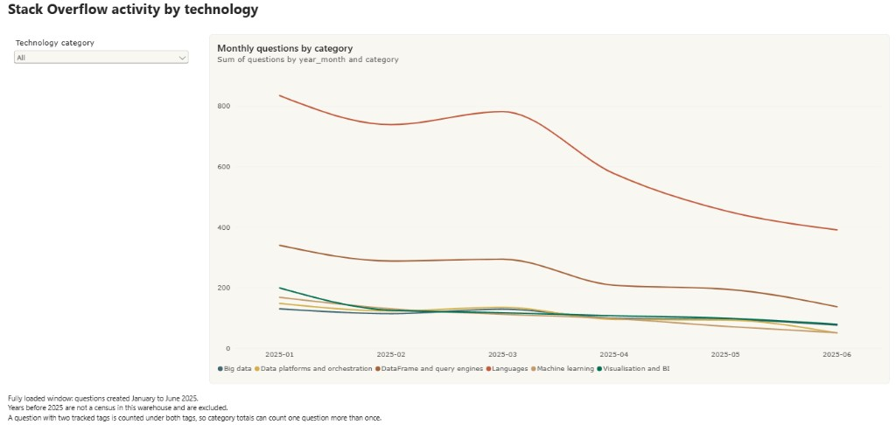
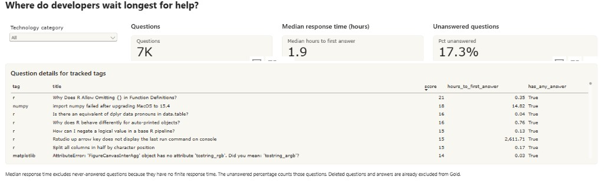
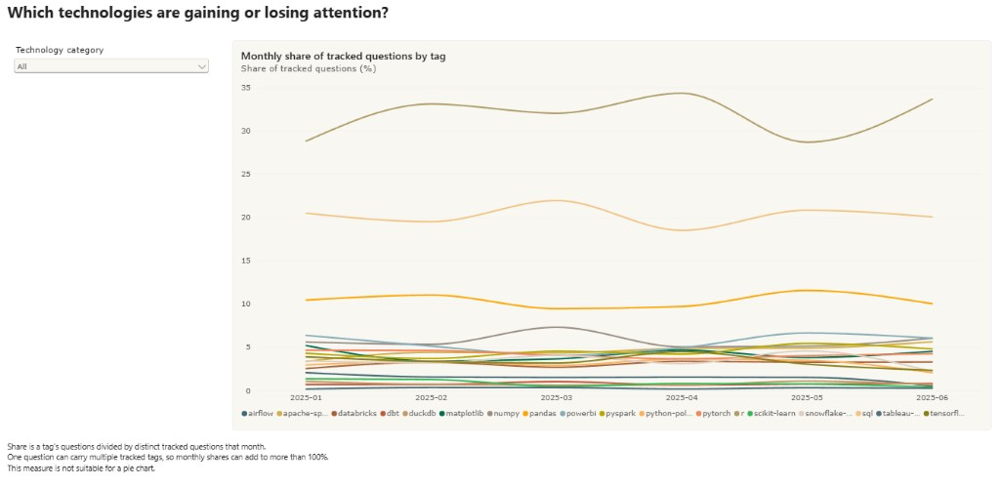
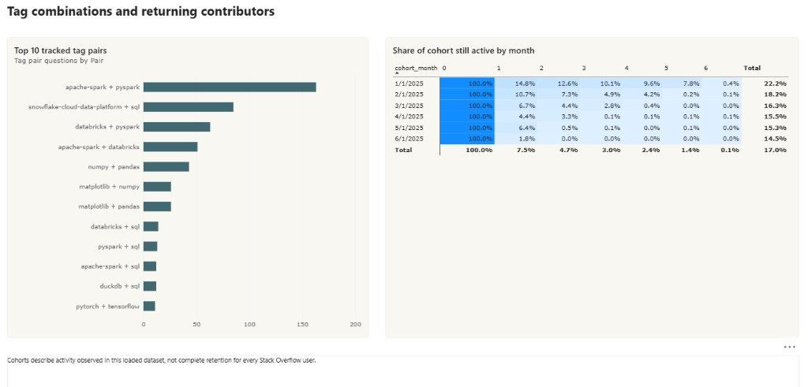
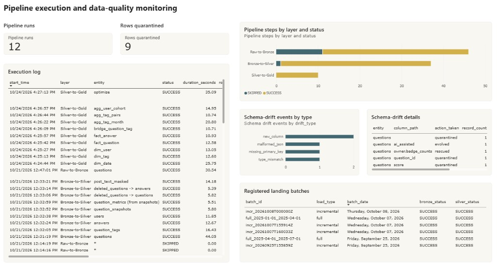

# Phase 3 Evaluation Prep: Gold, Power BI and the Final Report

**Team:** Muhammad Sufyan (24L-2601), Muaaz Fahad (24L-2563). **Course:** Data Analysis and Visualization.

This guide prepares you for the Phase 3 evaluation and for a final evaluation that covers the whole lakehouse. Bronze and Silver are already written up in [evaluation_prep.md](evaluation_prep.md). Read that for schemas, `MERGE`, drift, PII and the log table. This document covers what Phase 3 added: the Gold star schema, the job that refreshes it, the five Power BI pages, and the four topics in the final report (architecture, decisions, Spark UI, FinOps).

For every point, be ready to **show it**, not only describe it. The report is [phase3_report.pdf](phase3_report.pdf). The dashboard is `stackoverflow_gold_complete.pbix` in the repo root. The Databricks proof is [evidence/phase3](../evidence/phase3).

---

## 1. The 90-second pitch

Learn this so you can say it without notes.

"Phases 1 and 2 built a Medallion lakehouse on Databricks Free Edition for Stack Overflow questions and answers on 18 data and analytics tags. Landing files go to a Unity Catalog volume. Bronze types them with explicit schemas and keeps the source batch on every row. Silver cleans them, removes personal data, and upserts with `MERGE INTO`.

Phase 3 adds Gold. It is a star schema, not a copy of Silver: two facts, three dimensions, a tag bridge, and three aggregate tables for the business questions. The same Databricks job runs Bronze, then Silver, then Gold. Gold rebuilds each table from current Silver and applies the difference with `MERGE`, including a delete for rows that no longer belong, so a deleted question disappears from the dashboard on the next run. Every Gold table writes a log row with rows read, inserted, updated, deleted and the time taken.

Power BI imports Gold and the audit tables from a serverless SQL warehouse. Five pages answer the three Phase 1 questions, the tag-pair and cohort stretch goals, and pipeline health. The final report has the architecture, the decision log for partitioning, schema drift and PII, a Spark DAG with the shuffles and the predicate pushdown, and a FinOps estimate: about 49 cents for one daily run, about 6,700 dollars a year if we ran it every hour, and about 2,100 dollars a year after the optimisations we list."

---

## 2. The project on one page

### Architecture

```
Stack Exchange API
      |  ingestion/full_load.py, incremental_load.py
      v
Landing   /Volumes/workspace/so_raw/landing/{full|incremental}/<batch_id>/
      |  notebooks/01_raw_to_bronze   ->  bronze.py     replaceWhere on _batch_id
      v
Bronze    workspace.so_bronze          raw, typed, one row per record per batch
      |  notebooks/02_bronze_to_silver ->  silver.py    MERGE, newer and different
      v
Silver    workspace.so_silver          one current, PII-safe row per entity
      |  notebooks/05_silver_to_gold   ->  gold.py      MERGE on record_hash, delete stale
      v
Gold      workspace.so_gold            star schema and the three aggregates
      |
      +-- so_ops   pipeline_execution_logs, batch_registry, schema_drift_events
      |
      v
Power BI  stackoverflow_gold_complete.pbix   Import from the SQL warehouse
```

The job is `so_lakehouse_pipeline`, id `9643702855642`. Three tasks, each depending on the one before it, one retry each. Gold has no schedule of its own. The daily 06:00 UTC schedule is in the job file and is **paused**, because Free Edition caps daily compute. Say that out loud if asked. We start it with Run now.

### Gold tables

| Table | Grain | Rows after 17 Nov 2026 | What a row is |
|---|---|---|---|
| `fact_question` | one non-deleted question | 7,651 | the question, plus hours to first answer and answered-within-24h |
| `fact_answer` | one answer on a non-deleted question | 9,658 | the answer, plus a flag for whether it was the accepted one |
| `bridge_question_tag` | one question and one tag | 24,295 | how a question carries many tags |
| `dim_date` | one calendar day, key `YYYYMMDD` | 6,606 | year, month, and `is_after_chatgpt` |
| `dim_tag` | one tag | 2,822 | the tag and a technology category; 18 are `is_tracked` |
| `dim_user` | one pseudonymous user | 8,391 | `user_key`, reputation band, cohort month. No name |
| `agg_tag_month` | tracked tag and month | 377 | questions, median hours, share of tracked questions |
| `agg_tag_pairs` | two tracked tags on the same question | 62 | how often that pair appears |
| `agg_user_cohort` | first-post month and months since | 17,419 | share of that cohort still posting |

Deleted questions are left out of every Gold table. Silver still has them, marked deleted, so we can audit them.

### Numbers to remember (job run `1005795510073716`, 17 Nov 2026)

| Fact | Value |
|---|---|
| What we loaded | one real incremental batch, `incr_20261117T202706Z`: 33 questions (5 new, 28 updated), 49 answers, 19 API calls |
| Job result | all three tasks SUCCESS, 10 min 19 s wall clock |
| Task times | Bronze 205 s, Silver 187 s, Gold 218 s |
| Gold log | 10 rows, layer `Silver-to-Gold`, mode `refresh` |
| Questions through Gold | Silver inserted 32 and updated 1; Gold did the same |
| Answers through Gold | Silver inserted 49; Gold inserted 49 |
| What Gold actually wrote | it read about 84,000 rows and wrote about 2,000, because unchanged rows are skipped |
| `OPTIMIZE` / clustering | 37.6 s, logged as its own step |
| One daily run, estimated | 1.39 DBU, **$0.49** at list price (range $0.36 to $0.69) |
| Hourly for a year | about **$6,700**; about **$2,100** after the optimisations |
| Proof if the live demo fails | `evidence/phase3/silver_to_gold.ipynb`, last cells are the log rows |

The dashboard numbers (7K questions, 1.9 hour median, 17.3% unanswered) come from the January to June 2025 window, which is what the two full loads covered. Do not mix them up with the 33 questions in the November batch. The batch is a pipeline proof. The pages are a business proof.

---

## 3. The Phase 3 rubric, line by line

### 3.1 Star schema, not a copy of Silver

**What they want:** Gold shaped for analysis, with facts, dimensions and a stated grain.

**What we did:** `gold.py` reads the current Silver tables and builds nine Gold tables. Facts hold measures. Dimensions hold the attributes you slice by. Aggregates are precomputed because a median and a share are awkward to rebuild in every visual.

Silver `questions` is one wide row: owner reputation, last activity, tags as a separate table. Gold splits that. `fact_question` keeps `hours_to_first_answer`, `answered_within_24h` and `has_any_answer`. Reputation band, cohort month and the after-ChatGPT flag live on dimensions.

**Show it:** Catalog, `workspace.so_gold`, or section 3 of the report. In Power BI, Model view: facts in the middle, dimensions on the one side.

**If asked why not just point Power BI at Silver:** Silver is the cleaned system of record. It still has pipeline columns, and a median over a bridge is slow and easy to get wrong in every report. Gold is the contract the dashboard is allowed to use.

### 3.2 ER diagram and data dictionary

**What they want:** keys, relationships, column names and types, written down.

**What we did:**

- [gold_model.md](gold_model.md) defines the grain and each metric.
- [data_dictionary.md](data_dictionary.md) lists every column. It is generated from the `StructType` objects in `schemas.py`, so it cannot drift from the code.
- Figure 2 of the report is the ER diagram.
- Eight foreign keys are declared in Unity Catalog by `ddl.py` (`ensure_foreign_keys`). A foreign key has to point at a primary key, so `agg_tag_month.month_start` and `agg_user_cohort.cohort_month` are **not** Unity Catalog foreign keys: they point at `dim_date.full_date`, which is not the primary key (`date_key` is). Those two relationships exist only in Power BI. Say this before they find it.

**Are the keys enforced?** No. Unity Catalog primary and foreign keys are informational, same answer as Phase 2. Uniqueness comes from the `MERGE` key. `NOT NULL` on key columns is enforced by Delta.

### 3.3 Read optimisation (optional, we did it)

**What they want:** partitioning, `OPTIMIZE`, Z-order or liquid clustering, with a reason.

**What we did:** no Hive partitions on any table. After every Gold refresh, `step_optimize` runs liquid clustering and `OPTIMIZE` on the tables the dashboard filters:

| Table | Clustered by | Why |
|---|---|---|
| `fact_question`, `fact_answer` | `created_date_key` | every business page filters by date |
| `bridge_question_tag` | `tag` | the tag slicer filters through the bridge |
| `agg_tag_month` | `month_start` | the monthly charts |

On Databricks that is `ALTER TABLE ... CLUSTER BY` then `OPTIMIZE`. Local Spark uses `OPTIMIZE ... ZORDER BY` on the same columns, because open-source Delta 3.2 has no liquid clustering. The 17 Nov run logged this step in 37.6 seconds.

**Why not partition?** The Phase 1 size estimate is 1.5 to 2 GB for the full history. Partitioning `fact_question` by day would put 7,651 rows into thousands of folders. That is the small-files problem. Clustering gives the same file skipping, and the key can be changed later with `ALTER TABLE` instead of rewriting the layout forever. Full argument is report section 6.1.

### 3.4 Gold runs at the end of the pipeline

**What they want:** Gold refreshes when the pipeline runs, not as a notebook someone remembers to open.

**What we did:** `jobs/so_lakehouse_pipeline.job.json`. Task `silver_to_gold` depends on `bronze_to_silver`, which depends on `raw_to_bronze`. A backfill uses the same parameters and also ends in a Gold refresh. Gold never runs on stale Silver, and it never has its own clock.

**Show it:** the job page in Databricks, the task graph, then run `1005795510073716` or the notebook in `evidence/phase3`.

### 3.5 Logging of Silver to Gold

**What they want:** rows aggregated and execution time, in the same log as the other layers.

**What we did:** one row per Gold table in `so_ops.pipeline_execution_logs`, plus one row for `OPTIMIZE`. Columns match Phase 2: `layer = 'Silver-to-Gold'`, `run_mode = 'refresh'`, `start_time`, `end_time`, `duration_seconds`, `status`, and the row counts. The `message` column says what was aggregated, for example "aggregated 7651 current questions; excluded 1 deleted".

The 17 Nov Gold rows:

| Table | Read | Inserted | Updated | Seconds |
|---|---|---|---|---|
| `dim_date` | 6,606 | 41 | 0 | 14.3 |
| `dim_tag` | 2,822 | 11 | 0 | 12.9 |
| `dim_user` | 8,391 | 59 | 17 | 12.3 |
| `fact_question` | 7,652 | 32 | 1 | 17.2 |
| `fact_answer` | 9,658 | 49 | 0 | 15.6 |
| `bridge_question_tag` | 24,295 | 113 | 0 | 14.4 |
| `agg_tag_month` | 8,271 | 20 | 40 | 27.5 |
| `agg_tag_pairs` | 8,271 | 0 | 4 | 16.5 |
| `agg_user_cohort` | 8,389 | 288 | 1,392 | 20.1 |
| `optimize` | | | | 37.6 |

**Show it:** the Audit page, or the last cell of `evidence/phase3/silver_to_gold.ipynb`. If the `.pbix` was not refreshed after 17 Nov, the Audit page still ends on 24 Oct. Say so, and use the evidence notebook for the latest run.

**How the refresh stays idempotent:** each table is rebuilt in memory from all current Silver, then:

```sql
MERGE INTO so_gold.<table> t
USING src s
ON t.<key> = s.<key>
WHEN MATCHED AND NOT (s.record_hash <=> t.record_hash) THEN UPDATE SET ...
WHEN NOT MATCHED THEN INSERT ...
WHEN NOT MATCHED BY SOURCE THEN DELETE
```

`record_hash` is a SHA-256 of the business columns, not of `load_timestamp`. A second run on unchanged Silver inserts, updates and deletes nothing. That is `test_silver_to_gold_rerun_changes_nothing`. The `DELETE` clause is why a question Silver has just marked deleted leaves Gold on the next refresh.

**Why recompute everything instead of only the changed rows:** one changed answer can move a median, a share and a cohort for an earlier month. Recomputing is the correct answer at this size. The hash keeps the write small. Change data feed is the optimisation we would switch to when history is large. That is report section 6.4.

### 3.6 Power BI

**What they want:** connected to Databricks, the Phase 1 questions answered, audit and error visuals, a star model with one-to-many relationships, at least three visuals.

**What we did:** `stackoverflow_gold_complete.pbix`. Databricks connector, SQL warehouse `44ea9d68f2743938`, catalog `workspace`, personal access token, **Import** mode. Import is right here: Gold is small, and the report still opens when the warehouse is stopped.

The model has the nine Gold tables, three `so_ops` tables, and a measures table called `Measures (2)`. Relationships are many-to-one, single direction, except `bridge_question_tag` to `fact_question`, which filters **both ways**. That is what lets a tag slicer reach the questions. The measures are DAX on the facts, so a slicer filters them. Do not put the pre-aggregated median column on a card and sum it.

There are five pages and well over three visuals. Section 4 of this guide is the walkthrough. The click-by-click build is [powerbi_guide.md](powerbi_guide.md).

### 3.7 The report itself

**What they want:** a PDF with an architecture diagram, a decision log, a Spark UI DAG with an explanation, and a FinOps section.

**What we hand in:** [phase3_report.pdf](phase3_report.pdf), 14 pages.

| They asked for | Report section | Figure |
|---|---|---|
| Architecture | 2 | Figure 1 |
| ER and dictionary | 3 | Figure 2 |
| Decisions: partitioning, drift, PII | 6 | |
| Spark DAG, shuffles, predicate pushdown | 7 | Figures 8 and 9 |
| Daily cost, hourly yearly cost, optimisations | 8 | |
| The dashboard | 5 | Figures 3 to 7, one per page |

Talking points for sections 6, 7 and 8 are in sections 5, 6 and 7 of this guide. Do not try to memorise the PDF. Memorise the decisions and the three cost numbers.

---

## 4. The Power BI pages

Open the `.pbix` on a Windows machine with Power BI Desktop. If it asks for the Databricks token, paste a current personal access token. Then **Home, Refresh** if you want the Audit page to include the 17 Nov run. The warehouse must be running for a refresh. The other pages will barely move, because the November batch is 33 questions on top of about 7,600.

Before the pages, open **Model view** and say this:

"Gold is a star. `fact_question` and `fact_answer` are the facts. `dim_date`, `dim_tag` and `dim_user` are the one side. The bridge is how one question has many tags. Eight of these are foreign keys in Unity Catalog. The bridge filters both ways so a tag slicer reaches the questions. Two date links, from the aggregates to `dim_date.full_date`, exist only here, because a foreign key has to point at a primary key and that column is not the key."

Then walk the pages in this order. It is the order of the business questions.

### 4.1 Activity — which technologies lead, and is volume changing?

**The question, from Phase 1:** how has question volume changed, and which technology groups account for it?

**Tables:** `agg_tag_month`, filtered to `year_month` from `2025-01` through `2025-06`. Slicer on `dim_tag.category`.

**What is on the page:**

- A dropdown slicer, Technology category, default All.
- One line chart, Sum of questions by month, one line per category.

**What it shows:** Languages (`sql` and `r`) sit far above the other categories, starting near 800 questions in January and falling to about 400 by June. Data platforms and orchestration is next, falling from the mid-300s to under 150. Big data, machine learning, visualisation and the DataFrame category are all under 200 and also fall after March. Every category declines across the window. Languages lead in every month.



**What to say:** "This is the fully loaded window, questions created January to June 2025. Languages dominate. I am not using this chart to claim a post-ChatGPT decline. We only fully loaded these six months. The yearly decline in the Phase 1 proposal came from API count queries, not from this warehouse. `dim_date.is_after_chatgpt` is ready for that comparison once a full history is loaded."

**Traps:**

- A question with two tracked tags is counted in both. Summing categories can count one question twice. The text box on the page says this. The distinct count is the Questions measure, and it lives on the Response Time page.
- Do not put `month_name` on an axis. April sorts next to August. `year_month` is `YYYY-MM`, so alphabetical order is time order.
- If the chart is near zero before 2025 and spikes in 2025, the page filter was lost. Put it back.

### 4.2 Response Time — where do developers wait longest?

**The question:** which tags are slow to get a first answer, and which are often never answered?

**Tables:** `fact_question`, `dim_tag`, `dim_date`, and the measures. Not `agg_tag_month`. Averaging six monthly medians is not the median of the half-year.

**Page filter:** `dim_date.year = 2025` and `dim_date.month` in 1 to 6. The date reaches the questions through `created_date_key`.

**What is on the page:**

| Visual | Field | What it answers |
|---|---|---|
| Card | `Questions` | distinct questions in the window: **7K** |
| Card | `Median hours to first answer` | typical wait, blanks ignored: **1.9 hours** |
| Card | `Pct unanswered` | share with no surviving answer: **17.3%** |
| Bar chart | median hours by tag, `is_tracked = True` | who waits longest |
| Bar chart | percent unanswered by tag, same filter | who is left without an answer |
| Table | tag, title, score, hours, has any answer | a real question you can point at |

**What it shows:** across the window the typical answered question gets a first answer in 1.9 hours, and 17.3% never get one. The slow tags are TensorFlow, Airflow, dbt, then tableau-api, Spark and Databricks. The fast, well-answered tags are the big ones: pandas, sql, r, in the range of an hour. The unanswered chart tells a different story from the wait chart. PyTorch, Power BI and scikit-learn have the largest unanswered share, around a quarter to a third. A tag can be fast when it is answered and still often unanswered. That is why there are two charts.



**What to say:** "The median ignores questions that were never answered, because a median cannot include 'never'. The 17.3% card is where 'never' is counted. Deleted questions are already gone from Gold. `tableau-api` is a small tag, so a high bar there is a handful of questions, not a trend. The table is the drill-through: public titles, scores and waits, and no user names."

**The measures, if they ask you to open one:**

```
Questions = COUNTROWS ( fact_question )

Median hours to first answer = MEDIAN ( fact_question[hours_to_first_answer] )

Pct unanswered =
DIVIDE (
    CALCULATE (
        COUNTROWS ( fact_question ),
        fact_question[has_any_answer] = FALSE ()
    ),
    COUNTROWS ( fact_question )
)
```

`MEDIAN` skips blanks. Gold stores a null `hours_to_first_answer` when there is no answer, which is the same rule.

**Traps:**

- If every bar shows the same number, the bridge relationship is filtering one way only. It must be Both.
- If the median is in the hundreds of thousands, the visual is summing `agg_tag_month.median_hours_to_first_answer`. Replace it with the measure.
- If the Questions card shows the full unfiltered total (about 7,619), the page filter is off.
- The charts used to have a Top N filter on a ranking measure, and that measure failed to evaluate. We removed it. The charts now show all 18 tracked tags, sorted descending. That is the intended view. There are only 18 tracked tags, so Top N was not buying anything.

### 4.3 Share — who is gaining or losing attention?

**The question:** within the tracked set, which technologies are taking a larger share of the conversation?

**Tables:** `agg_tag_month`, same `2025-01` to `2025-06` filter. Slicer on category.

**What is on the page:** one line chart. Y-axis is `share_of_tracked_questions`. Legend is the tag.

**What the metric is:** this tag's questions that month, divided by the distinct tracked questions that month, times 100. A question with two of our tags counts in both shares and only once in the denominator. The shares of one month can add up to more than 100%. That is the definition, not a bug. A pie chart would be wrong, and Power BI would draw it anyway.

**What it shows:** `sql` stays near a third of tracked questions. `pandas` stays near a fifth. `pyspark` stays near a tenth. Most other tags sit between 1% and 7%, and they are flat. Nobody in this window is taking the conversation over. The interesting movement is small: a few tags rise into spring and settle back.



**What to say:** "Pick one category before you read it. All 18 lines at once is noise. Languages shows `sql` and `r` as the two large shares. Big data shows `apache-spark` and `pyspark` moving together, which fits, because they are usually the same questions tagged twice. The axis is already a percent. We did not also set the format to Percentage, or Power BI would show 1,200%."

### 4.4 Pairs and Cohorts — two stretch goals from Phase 1

**The questions:** which technologies are discussed together, and do the people who ask once come back?

These two visuals do not share a slicer. There is **no** relationship from `agg_tag_pairs` to `dim_tag`. A pair has two tags, and Power BI can keep only one of those relationships active, which would silently drop half the pairs.

**Left, top 10 tag pairs.** Bar chart of `agg_tag_pairs.question_count`. `tag_a` is alphabetically before `tag_b`, so each pair appears once. There is no date on this table. It covers every non-deleted question in Gold, which in practice is the 2025 window.

**What it shows:** `apache-spark` with `pyspark` is by far the most common pair, on the order of 160 questions. Then `snowflake-cloud-data-platform` with `sql`, `databricks` with `pyspark`, and `apache-spark` with `databricks`. The rest of the top 10 are the scientific-Python pairs (`numpy` with `pandas`, `matplotlib` with each of them) and a few platform-plus-`sql` pairs. The story is that the big-data tags are one conversation, and the Python data stack is another.

**Right, cohort matrix.** Rows are `cohort_month` (the month of a user's first post in this data). Columns are `months_since`, 0 to 6. Values are `share_still_active`. Month 0 is always 100%, because that is the month they first posted.

**What it shows:** of the people whose first post in this data falls in the first half of 2025, about **7.5%** post again one month later and about **1.4%** are still posting five months later. The total row fades from 100% to well under 10% by month two. The January cohort retains a bit better (about 14.8% at month one) than the later ones.



**What to say:** "This is activity observed in the loaded data, not the retention rate of Stack Overflow. A user whose first post was in 2019 only appears here if one of their old questions was touched by a batch we loaded. That is why the matrix is filtered to 2025 cohorts. We also cannot see posts on tags we do not collect, so 'stopped posting' means 'did not post again on these 18 tags'."

### 4.5 Audit — did the pipeline run, and did it fail?

**The question:** can we see pipeline health without opening Databricks?

**Tables:** only `so_ops`. Nothing on this page uses a Gold table. `pipeline_execution_logs` is one row per step. `batch_registry` is one row per landing batch. `schema_drift_events` is one row per new column, type change or bad line.

**What is on the page:**

| Visual | What it shows |
|---|---|
| Pipeline runs card | distinct `run_id` |
| Rows quarantined card | sum of `rows_quarantined` |
| Stacked bar | steps by layer (`Raw-to-Bronze`, `Bronze-to-Silver`, `Silver-to-Gold`) and by status |
| Execution log | start time, layer, entity, status, seconds, rows read, inserted, updated, deleted, message |
| Drift by type | bar of `drift_type` |
| Drift detail | entity, column, action taken, record count |
| Batch registry | batch id, full or incremental, date, Bronze status, Silver status |

**What the saved report shows, before a refresh:** 12 pipeline runs and 9 quarantined rows. The stacked bar is almost all SUCCESS, with a SKIPPED segment on the incremental re-runs that had nothing new to do. SKIPPED is a normal outcome, not a failure. FAILED would be its own colour. The log's newest rows in that file are the 24 Oct Gold run, including the `optimize` step at about 35 seconds.

The drift visual is the schema-drift demo, batch `incr_20261008T000000Z`:

| Drift | What we did |
|---|---|
| `ai_assisted` new column | evolved into Bronze with `mergeSchema` |
| `owner.badge_counts` new nested field | rescued into `_rescued_data` |
| `score = "five"` | quarantined, type mismatch |
| a row with no `question_id` | quarantined, missing primary key |
| a malformed line | quarantined |

Two good rows landed. The batch finished SUCCESS. That is the point: a few bad lines do not fail the batch.



**What to say:** "Every Bronze, Silver and Gold step writes one row: status, duration, and rows read, inserted, updated and deleted. The message column is where Gold records how many questions it aggregated and how many deleted ones it excluded, and where a failed step writes the error. Quarantine and drift have their own visuals. The batch table shows that full loads and incremental loads are both registered, and both reached Silver. If I tick status = FAILED in the visual filter, this table becomes the error list. It is empty, which is what we want."

**Refresh before the evaluation** if you can. The 17 Nov run will then appear at the top of the log, and the run card will go up by one. If the warehouse is asleep, start it, then Refresh. If refresh fails, do not pretend the page is current. Open `evidence/phase3/silver_to_gold.ipynb` and read the log from there. The numbers in section 3.5 of this guide are that run.

### 4.6 Five sentences that keep you out of trouble

1. The business pages are January to June 2025. That is the loaded window, not a census of Stack Overflow, and not a ChatGPT finding.
2. Share can add up to more than 100%, and category totals can count one question twice, because one question can carry two tracked tags.
3. The median excludes never-answered questions. The unanswered percent includes them. Quote both.
4. No visual shows a name, a profile link or a user id. `user_key` is a salted hash and is not on any visual.
5. The Audit page is only as fresh as the last Import refresh. The evidence notebooks are the source of truth for the 17 Nov run.

---

## 5. Decisions, in the form you will be asked

These are report section 6. Each one is a decision, the reason, and the alternative we rejected.

**Partitioning.** No Hive partitions. Bronze is idempotent per batch through `replaceWhere _batch_id = ...`, which Delta checks against file statistics, so we do not need a physical partition to replace one batch. Gold is filtered by date and tag, so liquid clustering on those columns gives the file skipping a partition would give, without the small-files problem and without a layout we cannot change. The alternative, partitioning `fact_question` by day, would spread 7,651 rows over thousands of folders.

**Schema drift.** Detected per batch in `drift.py`, before the write, by comparing each file with its `StructType`. New top-level fields are added with `mergeSchema` when `drift_mode = evolve`. New nested fields go to `_rescued_data`. Type mismatches, malformed JSON and missing primary keys are quarantined, and the rest of the file loads. The batch stays SUCCESS. Silver selects an explicit column list and casts every column, so a new Bronze column cannot leak into Silver or Gold. A `mergeSchema` write can drop a Unity Catalog primary key, so we re-apply it afterwards.

**PII.** Raw data stays in Bronze, which is the restricted layer. Display name, profile image, link and account id are dropped before Silver. `user_id` becomes `sha2(salt + ':' + user_id, 256)`. The salt is the Databricks secret `so_lakehouse/pii_salt`, never in the code. A plain hash would be reversible, because Stack Overflow ids are public and sequential. Emails, IPs, secrets and connection strings in text are masked, and that text lives only in `silver.post_text_masked`. Bodies are not in the main Silver tables, only the derived counts. Power BI loads Gold and `so_ops` only.

**Full recompute plus MERGE.** Rebuilding Gold from current Silver is correct, because one new answer changes old months and old cohorts. The hash makes it cheap: the 17 Nov refresh read about 84,000 rows and wrote about 2,000. The alternative, processing only the changed Silver rows, is what we would do with Delta change data feed once the history is large. At today's size the Gold step is about three and a half minutes, and most of that is overhead.

---

## 6. The Spark DAG in two minutes

**Why the screenshot is local Spark.** Databricks serverless compute has no Spark UI. It has a query profile. We ran the same package on Spark 3.5.3 and Delta 3.2.1, loaded the five demo batches, and captured the SQL tab for the hardest Gold step, `step_agg_tag_month`. Adaptive query execution was off so the static plan is readable. Databricks runs with it on, so it may merge the small shuffles. Say that. Do not claim the screenshot is from the Databricks job.

**What the query does.** It joins questions to the time of their first answer and to their tracked tags, then groups by tag and month for a distinct question count, a median and a share.

**Three shuffles, and why:**

| Shuffle | Partitioned by | Why it exists |
|---|---|---|
| 1 | `question_id` | partial aggregate of answers, then the earliest answer per question. 9,609 answers became 8,478 partial rows, then 6,333 questions with an answer |
| 2 | `tag, month_start, question_id` | first half of `count(distinct question_id)` |
| 3 | `tag, month_start` | the final grouping. 357 rows out |

Every aggregate is partial, then shuffle, then final. `count(distinct)` is why there are two grouping levels at the top. `ObjectHashAggregate` rather than `HashAggregate` is there because `percentile_approx` keeps a sketch object per group.

**Broadcast, not a fourth shuffle.** Both joins are `BroadcastHashJoin`. The first-answer side is about 1.25 MB and the tracked tag side is under the 10 MB threshold, so Spark copies them to every task and does not shuffle the questions table. A sort-merge join would have added two more shuffles.

**Predicate pushdown.** The tag list of 18 tags is pushed into the Parquet reader of `question_tags`, so row groups that cannot contain a tracked tag are skipped. The question scan reads 3 of 25 columns. `coalesce(is_deleted, false)` is **not** pushed, because Parquet filters cannot evaluate `coalesce`. Spark applies it in the Filter right after the scan. That is a good thing to say. It shows you read the plan.

**On the fact table.** A one-month filter on `created_date_key` reaches the reader as `GreaterThanOrEqual` and `LessThanOrEqual`. In the local run `OPTIMIZE` had compacted Gold into one file, so Delta could not skip files: 7,617 rows read, 1,092 matched. At a larger size, clustering on `created_date_key` puts a narrow date range in each file, and the same filter reads only that month's files.

Figures 8 and 9 of the report are the screenshot and the close-up of shuffle 1, the final aggregate of 6,333 questions, the broadcast and the join.

---

## 7. FinOps in two minutes

Free Edition charges nothing. `system.billing.usage` still records DBU, and `system.billing.list_prices` has the list price, so we priced our own usage.

**Prices we use:** Jobs serverless $0.35 per DBU, SQL serverless $0.70, all-purpose serverless $0.75, storage $0.023 per DSU. Region us-east-2, Premium.

**What we actually used, 10 to 29 Oct:** about $11.50 at list, $0 in reality. Jobs were the pipeline. SQL was queries and the Power BI import. Storage was under a dollar.

**The rate:** six job runs, 3,710 task-seconds, 8.45 DBU, so about **0.0023 DBU per task-second**. The rate varied by a factor of two between runs, because serverless scales. Every estimate below has a range for that reason.

**One daily run.** The 17 Nov job was 610 task-seconds. It was not in the billing table yet when we wrote the report, because billing lags by hours. At the measured rate that is **1.39 DBU and $0.49** (range $0.36 to $0.69). Most of the time is fixed. Empty steps still took about a minute, and starting three serverless tasks costs more than reading 33 questions. A quiet day costs almost the same as a busy one.

**Hourly for a year,** which is the question they asked:

| Piece | A year |
|---|---|
| Pipeline, 8,760 runs at 1.39 DBU | $4,262 |
| Power BI import refresh after every run, small SQL warehouse, about 6 minutes warm | $2,453 |
| Storage, about 10 GB | under $5 |
| Total | **about $6,700** |

**How we would cut it, in the order we would actually do them:**

1. The three business questions are monthly. Run Gold and the Power BI refresh daily. Keep hourly ingestion only if someone needs fresher Bronze.
2. One Spark session for all three steps, instead of three task startups. Saves about 130 seconds a run.
3. Skip a `MERGE` when Bronze already logged zero rows. Saves about 57 seconds.
4. `OPTIMIZE` once a day, or leave it to predictive optimisation, which is already on. Saves 38 seconds an hour.
5. Refresh Power BI four times a day. The BI line falls from $2,453 to about $410.

Those five bring the hourly design to about **$2,100 a year**. The cheapest design that still answers the questions is one daily run: 365 times $0.49 is about **$180**, plus about $100 for a daily refresh.

Power BI licences are not in these numbers. Neither are discounts.

---

## 8. Live demo, about 12 minutes

Do this the day before: pull `main`, open the `.pbix`, refresh it, and confirm the Response Time bars draw. Open the job in Databricks and confirm the warehouse can start. If the quota is spent, skip the live run and use the evidence notebooks. Say that you are showing a saved run, not pretending it is live.

| Minute | What you do | What you say |
|---|---|---|
| 0–1 | Repo page, then the architecture figure in the PDF | The pitch from section 1, shortened |
| 1–3 | Databricks, job `so_lakehouse_pipeline`, task graph | "Gold cannot run unless Silver succeeded. The schedule is paused on purpose." |
| 3–5 | Open `evidence/phase3/silver_to_gold.ipynb`, scroll to the log table | Read two rows: `fact_question` inserted 32 and updated 1, matching Silver. Point at the message that says one deleted question was excluded |
| 5–6 | Catalog, `so_gold.fact_question`, primary key, then one foreign key | "Informational. Uniqueness is the MERGE." |
| 6–11 | Power BI, Model view, then the five pages in order | Section 4, one sentence per page. Click the category slicer on Activity. Hover a Response Time bar so the tooltip shows that tag only |
| 11–12 | PDF sections 7 and 8, the DAG and the cost table | Section 6 and 7 of this guide, the short versions |

If they want a failure, you do not need to break anything. On the Audit page, point at the drift visual and walk the five bad lines. On the log, show that the batch stayed SUCCESS.

SQL you can paste if they ask for Gold counts:

```sql
SELECT 'fact_question' AS t, COUNT(*) AS n FROM workspace.so_gold.fact_question
UNION ALL SELECT 'fact_answer', COUNT(*) FROM workspace.so_gold.fact_answer
UNION ALL SELECT 'bridge', COUNT(*) FROM workspace.so_gold.bridge_question_tag;

SELECT entity, rows_read, rows_inserted, rows_updated, rows_deleted,
       ROUND(duration_seconds, 1) AS seconds, status
FROM workspace.so_ops.pipeline_execution_logs
WHERE layer = 'Silver-to-Gold'
ORDER BY start_time DESC
LIMIT 20;
```

---

## 9. Questions they may ask

Bronze, Silver, `MERGE`, drift and the salt are in section 6 of [evaluation_prep.md](evaluation_prep.md). These are the Phase 3 ones.

**Gold**

1. **Why is Gold not a copy of Silver?** Silver is the cleaned record, one wide row per entity, with pipeline columns. Gold is the shape the questions need: facts, dimensions, and aggregates whose definitions we control in one place.
2. **What is the grain of `fact_question`?** One non-deleted question. Answers on a deleted question are excluded too.
3. **Walk through the Gold MERGE.** Match on the key. Update only when `record_hash` differs. Insert new keys. Delete target rows the new build did not produce. The hash ignores `load_timestamp`, so a rerun that changes nothing writes nothing.
4. **Why `WHEN NOT MATCHED BY SOURCE THEN DELETE`?** So a question Silver marks deleted leaves the dashboard on the next refresh. Without it, Gold would only grow.
5. **Why recompute all of Gold?** One new answer changes an old month's median and an old cohort. Recomputing is correct. The hash keeps the write small. Change data feed is the later optimisation.
6. **Why a bridge table?** A question has many tags. Putting tags on the fact would either repeat the question once per tag, which breaks the question count, or pack the tags into a string, which you cannot slice. The bridge holds the many side. It filters both ways so a tag slicer reaches the questions.
7. **Why are two relationships missing from Unity Catalog?** A foreign key must reference a primary key. `month_start` and `cohort_month` point at `dim_date.full_date`, and the primary key is `date_key`. Power BI holds those two.
8. **What does liquid clustering buy us?** Rows with close `created_date_key` values land in the same files, so a one-month filter skips the other files. We can change the key later. Partitioning a 7,651-row table by day would make it slower.

**Power BI**

9. **Why Import and not DirectQuery?** Gold is small. Import stays usable when the warehouse is stopped, and the visuals are instant. The cost is that the Audit page is stale until someone refreshes.
10. **Why is the median a measure and not the column in `agg_tag_month`?** The column is the median of one tag in one month. Summing or averaging it across months is not the median of the half-year. `MEDIAN` over `fact_question` is.
11. **Why can the share lines add up to more than 100%?** The denominator is distinct tracked questions. A question with two tracked tags counts in two shares and once in the denominator. A pie chart would hide that, so we did not draw one.
12. **Why does the Activity chart fall after March? Is that ChatGPT?** No. The warehouse fully loaded January to June 2025 only. The fall is inside that window, and we do not explain it as a platform-wide decline. The post-ChatGPT flag is on `dim_date` for when we load the real history.
13. **A tag is fast on one chart and badly unanswered on the other. Which is right?** Both. The median is computed only over questions that got an answer. The percent counts the ones that did not. PyTorch is the example to give.
14. **Why is there no relationship from tag pairs to `dim_tag`?** A pair has two tag columns. Power BI would keep one relationship active and drop half the pairs.
15. **What does the cohort matrix not say?** It does not say that 7.5% of Stack Overflow users return. It says that, of the users whose first post *in this loaded data* was in that month, 7.5% posted again on one of our 18 tags a month later.
16. **Where is the error visual?** The Audit page. Status is the colour on the stacked bar, the message column holds the failure text, and the drift charts are the data-quality errors. FAILED is empty in the saved run. The drift demo is the error story we can show.

**Report, Spark, cost**

17. **Why no partitions?** Section 5, first decision. Small-files problem, and `replaceWhere` already gives per-batch replacement.
18. **Show me a shuffle.** Figure 9. Exchange on `question_id`, 108.7 KiB, then the aggregate that leaves 6,333 questions, then a broadcast join into the questions stream.
19. **What did not get pushed down?** `NOT coalesce(is_deleted, false)`. Parquet cannot evaluate `coalesce`. The Filter above the scan does it.
20. **Why is the DAG not from Databricks?** Serverless has no Spark UI. Same code, local Spark, AQE off. Databricks would run this with AQE on.
21. **What does one day cost?** About $0.49 at list, $0 on Free Edition. Most of it is task startup, not the 33 questions.
22. **What does hourly for a year cost, and what would you change first?** About $6,700. First change: stop refreshing Gold and Power BI every hour. The questions are monthly. That, plus one session, skipping empty merges, daily `OPTIMIZE` and four BI refreshes a day, is about $2,100. Daily everything is about $280.

---

## 10. Who presents what

| Part | Presenter |
|---|---|
| Pitch, architecture, the job, "Gold runs at the end" | Member 1 |
| Star schema, keys, the Gold MERGE, the log rows | Member 1 |
| Power BI model view, Activity, Share | Member 2 |
| Response Time, Pairs and Cohorts, Audit | Member 2 |
| Decisions, the DAG, the three cost numbers | Whoever is not holding the laptop |

Both of you should be able to answer any question in section 9, and the Phase 2 questions in the other guide. Examiners ask the person who did not present the part.

---

## 11. Last-minute cheat sheet

- Job `9643702855642`, tasks Bronze then Silver then Gold, schedule paused on purpose.
- Run to quote: `1005795510073716`, 17 Nov, 619 s, all SUCCESS. Batch of 33 questions and 49 answers.
- Gold MERGE: update when the hash differs, insert new, delete rows no longer produced. Rerun writes nothing.
- 17 Nov Gold: questions +32 / 1 updated, answers +49, optimize 37.6 s. Evidence notebook if the Audit page is old.
- No Hive partitions. Liquid clustering on `created_date_key`, `tag`, `month_start`. Local Delta uses Z-order instead.
- Eight Unity Catalog foreign keys. `month_start` and `cohort_month` are Power BI only.
- PII: salt in `so_lakehouse/pii_salt`, no names in Gold, no `user_key` on a visual.
- Activity: Jan–Jun 2025, languages lead, every category falls after March. Not a ChatGPT chart. Tags double-count.
- Response Time: **7K** questions, **1.9 h** median, **17.3%** unanswered. Slow: TensorFlow, Airflow, dbt. Unanswered: PyTorch, Power BI, scikit-learn. Median skips the never-answered.
- Share: sql about a third, pandas about a fifth, pyspark about a tenth. Shares may sum past 100%. Not a pie.
- Pairs: Spark with PySpark is the dominant pair. Cohorts: 7.5% back after one month, 1.4% after five. Say "in this data".
- Audit: one log row per step, SKIPPED is normal, the drift demo quarantined three lines and stayed SUCCESS.
- DAG: three shuffles, two broadcast joins, 18-tag filter pushed down, `coalesce` not pushed down. Local Spark, because serverless has no Spark UI.
- Cost: **$0.49 a day**, **$6,700 a year hourly**, **$2,100** after the five optimisations, **about $280** if the whole job is daily. List price, Free Edition pays $0.
- Tests: `tests/test_pipeline.py`, 17 tests, including the Gold rerun that changes nothing.
