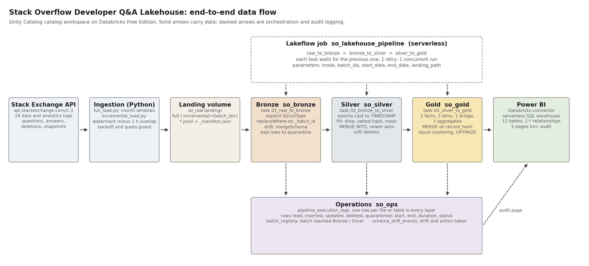
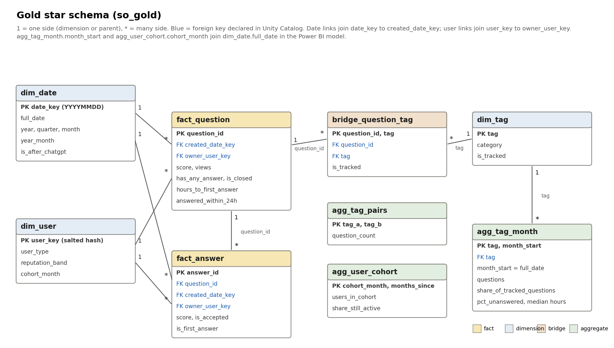
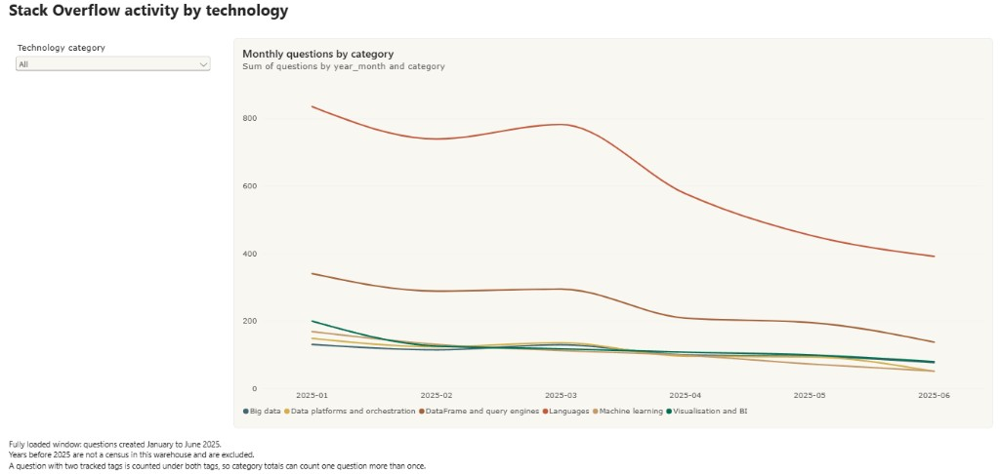
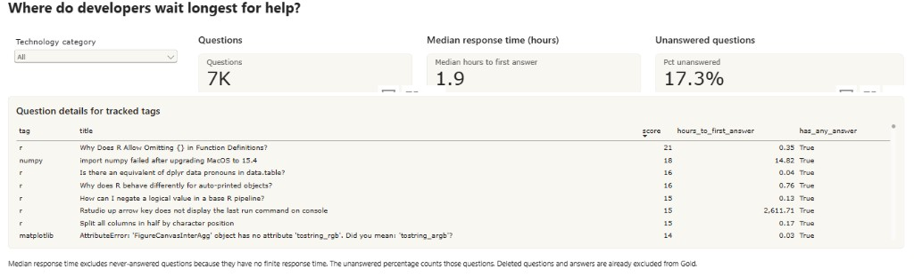
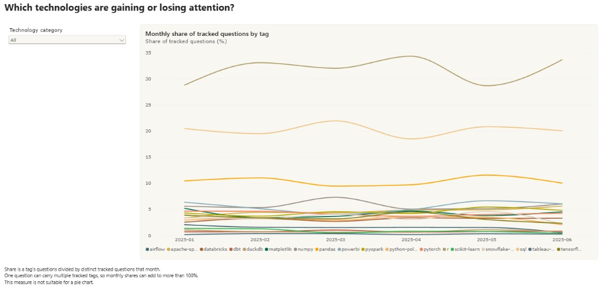
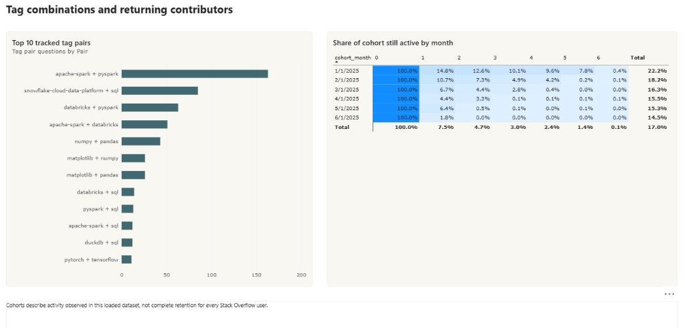
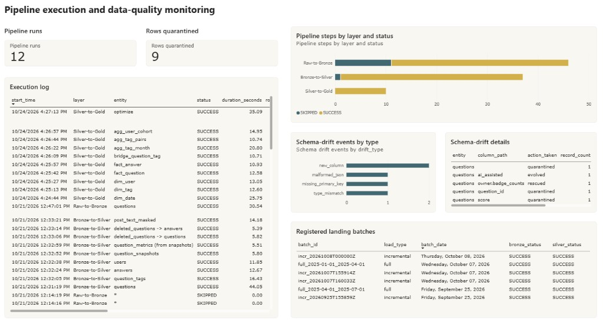
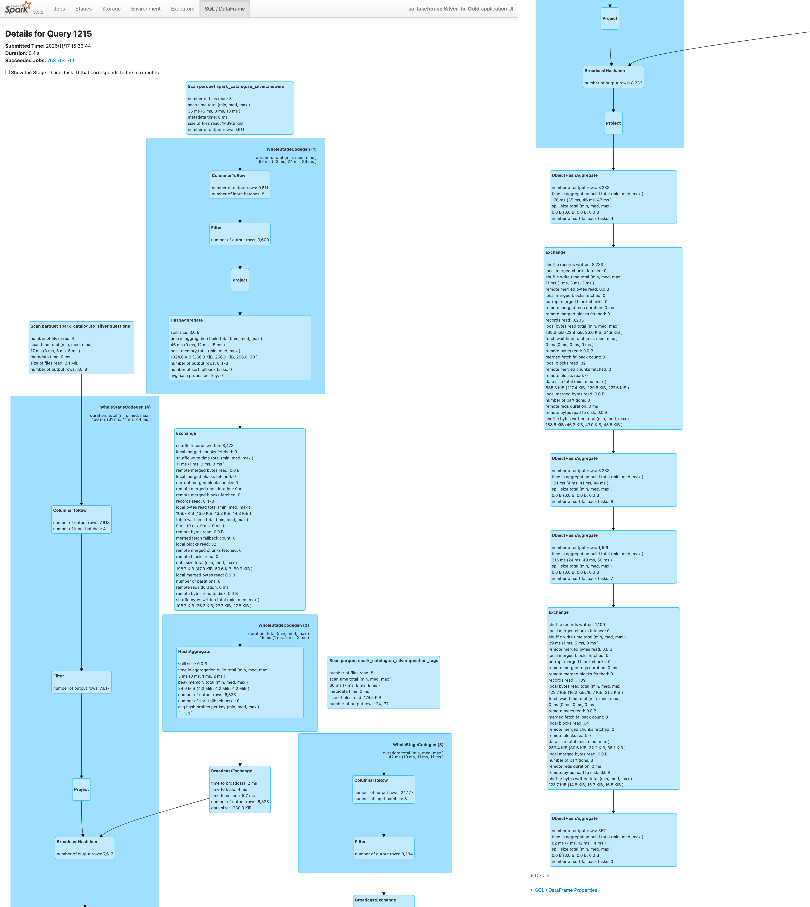

# Phase 3 Final Report: Gold Layer, BI and FinOps

- **Project:** Stack Overflow Developer Q&A Lakehouse
- **Course:** Data Analysis and Visualization
- **Team:** Muhammad Sufyan (24L-2601), Muaaz Fahad (24L-2563)
- **Repository:** https://github.com/Suf-7/stackoverflow-lakehouse
- **BI deliverable:** `stackoverflow_gold_complete.pbix` in the repository root
- **Platform:** Databricks Free Edition (AWS us-east-2), serverless compute, Unity Catalog catalog `workspace`

---

## 1. Summary

The pipeline pulls questions and answers for 18 data and analytics tags from the Stack Exchange API. Each batch is landed as JSON Lines in a Unity Catalog volume. Bronze types the raw records with explicit schemas. Silver cleans them, removes or pseudonymises personal data, and keeps one current row per entity with `MERGE INTO`. Phase 3 adds a Gold star schema that is refreshed by the same Databricks job, a Power BI report on top of Gold and the audit tables, and this report.

On 17 November 2026 we pulled a real 24-hour incremental batch from the API (33 changed questions, 49 answers) and ran the three-task job once. All three tasks succeeded in 10 minutes 19 seconds. Gold refreshed automatically after Silver and logged every table it wrote. That run is the "typical daily incremental run" used for the cost figures in section 8. Its notebooks, with their outputs, are in `evidence/phase3/`.

| Requirement | Where it is met |
|---|---|
| Star schema, not a copy of Silver | Section 3; `src/so_lakehouse/gold.py` |
| Gold data dictionary and ER diagram | Section 3; `docs/gold_model.md`; `docs/data_dictionary.md` |
| Read optimisation | Section 3.4: liquid clustering and `OPTIMIZE` after every refresh |
| Gold linked to the end of the pipeline | Section 4: task `silver_to_gold` depends on `bronze_to_silver` |
| Logging of Silver-to-Gold | Section 4.2: one log row per Gold table, with rows and seconds |
| BI connected to Databricks, star model, 3+ visuals, audit visuals | Section 5; `stackoverflow_gold_complete.pbix` |
| Architecture diagram | Section 2 |
| Decision log: partitioning, schema drift, PII | Section 6 |
| Spark UI DAG and analysis | Section 7 |
| FinOps evaluation | Section 8 |

<!-- pagebreak -->

## 2. Architecture



| Layer | Unity Catalog object | Written by | Write pattern |
|---|---|---|---|
| Landing | volume `so_raw.landing` | `ingestion/full_load.py`, `ingestion/incremental_load.py` | one folder per batch, never modified |
| Bronze | schema `so_bronze` (5 tables) | `notebooks/01_raw_to_bronze` | `replaceWhere _batch_id = ...` |
| Silver | schema `so_silver` (7 tables) | `notebooks/02_bronze_to_silver` | `MERGE INTO`, update only when newer and different |
| Gold | schema `so_gold` (9 tables) | `notebooks/05_silver_to_gold` | `MERGE INTO` on `record_hash`, delete rows no longer produced |
| Ops | schema `so_ops` (3 tables) | every layer | append (logs), `MERGE` (registry, drift) |
| BI | Power BI semantic model | Databricks connector, serverless SQL warehouse | Import |

All logic is in the Python package `src/so_lakehouse/`. The notebooks only read widget values and call one function. The same code runs in the Databricks job, from the command line, and in the local test suite (`tests/test_pipeline.py`, 17 tests on Spark 3.5 and Delta 3.2).

---

## 3. Gold dimensional model

### 3.1 Tables

Gold is a star schema with one bridge, built from the current Silver tables. Deleted questions, and the answers on them, are excluded.

| Table | Type | Grain | Rows after the 17 Nov run |
|---|---|---|---|
| `fact_question` | Fact | One non-deleted question | 7,651 |
| `fact_answer` | Fact | One non-deleted answer on a non-deleted question | 9,658 |
| `bridge_question_tag` | Bridge | One question and one tag | 24,295 |
| `dim_date` | Dimension | One calendar day, key `YYYYMMDD` | 6,606 |
| `dim_tag` | Dimension | One tag, with a technology category | 2,822 |
| `dim_user` | Dimension | One pseudonymous user | 8,391 |
| `agg_tag_month` | Aggregate | Tracked tag and month | 377 |
| `agg_tag_pairs` | Aggregate | Pair of tracked tags on the same question | 62 |
| `agg_user_cohort` | Aggregate | First-post month and months since | 17,419 |

Silver holds one wide current row per question with source fields such as `owner_reputation` and `last_activity_at`. Gold reshapes it. Facts carry measures and derived metrics (hours to first answer, answered within 24 hours, first-answer flag). Descriptive attributes move to dimensions (reputation band, cohort month, tag category, after-ChatGPT flag). Monthly and cohort results are pre-aggregated for the dashboard.

### 3.2 ER diagram



| Child table | Column | Parent table | Column | Declared in Unity Catalog |
|---|---|---|---|---|
| `fact_question` | `created_date_key` | `dim_date` | `date_key` | `fk_fact_question_created_date_key` |
| `fact_question` | `owner_user_key` | `dim_user` | `user_key` | `fk_fact_question_owner_user_key` |
| `fact_answer` | `question_id` | `fact_question` | `question_id` | `fk_fact_answer_question_id` |
| `fact_answer` | `created_date_key` | `dim_date` | `date_key` | `fk_fact_answer_created_date_key` |
| `fact_answer` | `owner_user_key` | `dim_user` | `user_key` | `fk_fact_answer_owner_user_key` |
| `bridge_question_tag` | `question_id` | `fact_question` | `question_id` | `fk_bridge_question_tag_question_id` |
| `bridge_question_tag` | `tag` | `dim_tag` | `tag` | `fk_bridge_question_tag_tag` |
| `agg_tag_month` | `tag` | `dim_tag` | `tag` | `fk_agg_tag_month_tag` |
| `agg_tag_month` | `month_start` | `dim_date` | `full_date` | Power BI only: a foreign key must point at a primary key |
| `agg_user_cohort` | `cohort_month` | `dim_date` | `full_date` | Power BI only, same reason |

The full column list, types and comments for every Gold table are in `docs/data_dictionary.md`. That file is generated from the `StructType` contracts in `src/so_lakehouse/schemas.py`, so the documentation cannot drift from the code. `docs/gold_model.md` defines each metric.

### 3.3 Refresh strategy

Each Gold table is rebuilt from current Silver in memory and applied with one `MERGE`:

```sql
MERGE INTO workspace.so_gold.fact_question AS t
USING src_gold AS s
ON t.question_id = s.question_id
WHEN MATCHED AND NOT (s.record_hash <=> t.record_hash) THEN UPDATE SET ...
WHEN NOT MATCHED THEN INSERT ...
WHEN NOT MATCHED BY SOURCE THEN DELETE
```

`record_hash` is a SHA-256 of the business columns, not of `load_timestamp`. A refresh only rewrites rows whose content changed, and a rerun on unchanged Silver inserts, updates and deletes nothing (tested by `test_silver_to_gold_rerun_changes_nothing`). The delete clause removes a question from Gold on the first refresh after Silver marks it deleted.

### 3.4 Read optimisation

After the merges, the last Gold step clusters and compacts the tables the dashboard filters:

| Table | Liquid clustering key | Why |
|---|---|---|
| `fact_question`, `fact_answer` | `created_date_key` | Every business page filters by date |
| `bridge_question_tag` | `tag` | The tag and category slicers filter through the bridge |
| `agg_tag_month` | `month_start` | Monthly trend and share charts |

On Databricks the step runs `ALTER TABLE ... CLUSTER BY (...)` and then `OPTIMIZE`. Locally it runs `OPTIMIZE ... ZORDER BY` on the same columns, because open-source Delta 3.2 has no liquid clustering. The 17 November run logged the step as `OPTIMIZE gold.fact_question CLUSTER BY (created_date_key); ...` in 37.6 seconds. Section 7.3 shows the date filter being pushed into the Parquet scan, which is what clustering makes effective.

---

## 4. Pipeline integration and automation

### 4.1 One job, three dependent tasks

`jobs/so_lakehouse_pipeline.job.json` defines the Lakeflow job `so_lakehouse_pipeline`, deployed as job `9643702855642`:

| Task | Notebook | Depends on | Retries |
|---|---|---|---|
| `raw_to_bronze` | `01_raw_to_bronze` | none | 1 |
| `bronze_to_silver` | `02_bronze_to_silver` | `raw_to_bronze` | 1 |
| `silver_to_gold` | `05_silver_to_gold` | `bronze_to_silver` | 1 |

Gold therefore runs every time Silver finishes successfully, and never on its own schedule. The job takes the Phase 2 parameters (`mode`, `batch_ids`, `start_date`, `end_date`, `landing_path`, `drift_mode`), so a backfill also ends with a Gold refresh. The daily 06:00 UTC schedule is in the job definition but is kept paused on Free Edition to stay inside the daily compute quota; the job is started with **Run now** or by the CLI.

### 4.2 The 17 November incremental run

Run `1005795510073716`, `mode=incremental`. Batch `incr_20261117T202706Z` was produced by `ingestion/incremental_load.py --since <now minus 24 h>`: 33 questions (5 new, 28 updated) and 49 answers, using 19 API requests.

| Task | Result | Task time | Logged step time |
|---|---|---|---|
| `raw_to_bronze` | SUCCESS | 205 s | 82.4 s over 10 steps |
| `bronze_to_silver` | SUCCESS | 187 s | 146.8 s over 9 steps |
| `silver_to_gold` | SUCCESS | 218 s | 188.4 s over 10 steps |
| Whole job | SUCCESS | 619 s wall clock | |

Rows from `so_ops.pipeline_execution_logs` for the Gold task:

| Gold table | Read | Inserted | Updated | Deleted | Seconds |
|---|---|---|---|---|---|
| `dim_date` | 6,606 | 41 | 0 | 0 | 14.3 |
| `dim_tag` | 2,822 | 11 | 0 | 0 | 12.9 |
| `dim_user` | 8,391 | 59 | 17 | 0 | 12.3 |
| `fact_question` | 7,652 | 32 | 1 | 0 | 17.2 |
| `fact_answer` | 9,658 | 49 | 0 | 0 | 15.6 |
| `bridge_question_tag` | 24,295 | 113 | 0 | 0 | 14.4 |
| `agg_tag_month` | 8,271 | 20 | 40 | 0 | 27.5 |
| `agg_tag_pairs` | 8,271 | 0 | 4 | 0 | 16.5 |
| `agg_user_cohort` | 8,389 | 288 | 1,392 | 0 | 20.1 |
| `optimize` | 0 | 0 | 0 | 0 | 37.6 |

The numbers line up across layers. Silver inserted 32 new questions and updated 1; Gold `fact_question` inserted 32 and updated 1. Silver inserted 49 answers; Gold `fact_answer` inserted 49. The `message` column records how many rows each step aggregated, for example "aggregated 7651 current questions; excluded 1 deleted" and "aggregated 8271 question-tag rows into 377 tag-months".

Each row also has `layer = 'Silver-to-Gold'`, `run_mode = 'refresh'`, `start_time`, `end_time`, `duration_seconds` and `status`, so Gold is logged exactly like the Phase 2 layers.

---

## 5. Business intelligence

### 5.1 Connection

Power BI Desktop connects with the **Databricks** connector to the serverless SQL warehouse (`/sql/1.0/warehouses/44ea9d68f2743938`), catalog `workspace`, using a personal access token. Import mode is used: the Gold tables are small, and the report stays usable when the warehouse is stopped. The setup is written step by step in `docs/powerbi_guide.md`.

### 5.2 Semantic model

The model has the nine Gold tables and three audit tables (`pipeline_execution_logs`, `batch_registry`, `schema_drift_events`), plus a measures table. Relationships follow figure 2: many-to-one from each fact or bridge to its dimension, single direction, except bridge to `fact_question`, which filters both ways so a tag slicer reaches the questions. `month_start` and `cohort_month` join `dim_date.full_date`. The measures (questions, median hours to first answer, percent unanswered, tag-pair and cohort measures, pipeline runs, steps and rows quarantined) are DAX on the facts, so slicers filter them correctly.

### 5.3 Pages

| Page | Business question | Visuals |
|---|---|---|
| Activity | Q1: how activity changed and which technologies lead | category slicer; line chart of questions by month and category |
| Response Time | Q2: where developers wait longest, which tags are under-served | 3 KPI cards; bars of median hours and percent unanswered for the 18 tracked tags; question table |
| Share | Q3: which technologies gain or lose attention | category slicer; line chart of share of tracked questions by tag |
| Pairs and Cohorts | stretch goals from Phase 1 | top-10 tag pairs; cohort retention matrix |
| Audit | pipeline health | pipeline runs and rows quarantined cards; steps by layer and status; log table; drift by type; drift detail; batch registry |











The loaded history is concentrated in January to June 2025, which is what the two full-load windows covered; 7,286 of the 7,619 questions loaded when the dashboard was built were created in 2025. The business pages are filtered to that window, so earlier years with only a few rows are not read as a trend. The multi-year decline in the Phase 1 proposal comes from API count queries; `dim_date.is_after_chatgpt` is ready to show it once a full-history load is run.

---

## 6. Decision log

### 6.1 Partitioning

**Decision: no Hive-style partitions on any table. Bronze replaces data by `_batch_id` through `replaceWhere`; Gold uses liquid clustering.**

- The full history is estimated at 1.5 to 2 GB of Delta (Phase 1). Databricks' guidance is to partition only tables well above that, with at least about 1 GB per partition. Partitioning `fact_question` by day would split 7,651 rows over thousands of folders, and even the full history would average a few hundred questions per day: the small-files problem, with slower reads, not faster.
- Bronze must be idempotent per batch. `replaceWhere _batch_id = '<batch>'` gives that without a physical partition, because Delta evaluates an arbitrary `replaceWhere` predicate against file statistics. A rerun or backfill of a batch replaces exactly that batch's rows (the Phase 2 backfill replaced 24,766 rows and added none).
- Gold is read through date and tag filters. Liquid clustering on those keys gives the file skipping a partition would give, without fixing a layout forever. The keys can be changed with `ALTER TABLE ... CLUSTER BY` and later `OPTIMIZE` runs only rewrite what is not yet clustered.

### 6.2 Schema drift

**Decision: drift is detected per batch and handled per field type. New fields evolve Bronze; broken records are quarantined; the batch never fails because of a few bad lines.**

`drift.py` compares each raw file with its `StructType` contract before writing:

| Drift | Action | Where it goes |
|---|---|---|
| New top-level field | `mergeSchema`, the Bronze table gains the column (`drift_mode=evolve`) | Bronze table, `so_ops.schema_drift_events` |
| New nested field | kept as JSON in `_rescued_data` | Bronze `_rescued_data`, drift events |
| Type mismatch | record quarantined, batch continues | `so_bronze.quarantine_records` |
| Malformed JSON line | record quarantined | `so_bronze.quarantine_records` |
| Missing primary key | record quarantined | `so_bronze.quarantine_records` |

It occurred in the test batch `incr_20261008T000000Z`: the event table recorded `ai_assisted` as a new column (evolved), `owner.badge_counts` as a new nested field (rescued), `score = "five"` as a type mismatch, one record without `question_id`, and one malformed line (all three quarantined). Two good rows landed and the batch finished with status SUCCESS. The API also varies on its own: optional fields such as `migrated_from`, `protected_date` and `posted_by_collectives` appear on a small share of records.

Silver selects an explicit list of columns and casts each to its contract type, so drift in Bronze cannot change Silver or Gold. A `mergeSchema` write can drop Unity Catalog constraints, so the pipeline re-applies the primary key after any evolving write.

### 6.3 PII

**Decision: keep raw data only in restricted Bronze; nothing that identifies a person reaches Silver, Gold or Power BI.**

| Data | Treatment |
|---|---|
| `owner.display_name`, `owner.profile_image`, `owner.link`, `owner.account_id` | dropped before Silver |
| `owner.user_id` | replaced by `user_key = sha2(salt + ':' + user_id, 256)`; salt in the Databricks secret `so_lakehouse/pii_salt`, never in code |
| Emails, IP addresses, credentials, connection strings in titles and bodies | masked as `[EMAIL]`, `[IP]`, `[SECRET]`, `[CONNECTION]` in the restricted table `silver.post_text_masked` |
| Bodies | not stored in the main Silver tables; only derived features (length, code blocks, links) |
| Deleted questions | soft-deleted in Silver, removed from Gold |

The salted hash keeps distinct users countable, which the cohort analysis needs, without storing the real id. The salt must stay constant, otherwise every user key would change. Power BI loads only Gold and `so_ops`, and no visual uses `user_key`. The report shows public question titles but no names, profile links or ids.

### 6.4 Gold refresh by full recompute and MERGE

**Decision: rebuild each Gold table from all current Silver rows and MERGE the difference, instead of processing only the changed Silver rows.**

Correctness: a single incremental batch can change a question's metrics, mark it deleted, or move an answer to accepted. Any of those changes the aggregates for an earlier month and the user cohorts. Recomputing from current Silver always gives the right answer. The hash condition limits rewrites to rows that actually changed: the 17 November refresh read 84,355 rows but wrote 2,067.

Cost: at the current size the Gold step costs about 3.5 minutes. Section 8.4 explains when to switch to change data feed.

<!-- pagebreak -->

## 7. Spark UI and DAG analysis

### 7.1 How the DAG was captured

Databricks serverless compute does not expose the Spark UI; it shows a query profile instead. To show the classic Spark DAG, we ran the same package locally on Apache Spark 3.5.3 with Delta Lake 3.2.1. It read the five demo landing batches into Bronze, then Silver, then Gold. The local refresh produced the same Gold shape as Databricks (7,617 questions and 357 tag-months for those batches). We then ran the core of the most complex Gold step, `step_agg_tag_month`. It joins questions to their first-answer time and to their tracked tags, then groups by tag and month for a distinct question count, a median and a share. Adaptive query execution was turned off so the static plan is visible. Databricks runs with it on.




### 7.2 What Spark did

The physical plan (`EXPLAIN FORMATTED`), shortened:

```
ObjectHashAggregate (26)                       final: count(distinct), percentile, avg
+- Exchange hashpartitioning(tag, month_start) (25)              shuffle 3
   +- ObjectHashAggregate (24)
      +- ObjectHashAggregate (23)
         +- Exchange hashpartitioning(tag, month_start, question_id) (22)   shuffle 2
            +- ObjectHashAggregate (21)                        partial aggregate
               +- BroadcastHashJoin Inner (19)                  questions x tracked tags
                  :- BroadcastHashJoin LeftOuter (13)           questions x first answer
                  :  :- Filter (3) <- Scan parquet so_silver.questions (1)
                  :  +- BroadcastExchange (12)
                  :     +- HashAggregate (11)                   min(created_at) per question
                  :        +- Exchange hashpartitioning(question_id) (10)      shuffle 1
                  :           +- HashAggregate (9) <- Filter (7) <- Scan so_silver.answers (5)
                  +- BroadcastExchange (18)
                     +- Filter (17) <- Scan parquet so_silver.question_tags (15)
```

**Shuffles.** Each `Exchange` is a shuffle and a stage boundary. The query has three:

| Exchange | Partitioned by | Rows written | Shuffle bytes | Why |
|---|---|---|---|---|
| (10) | `question_id` | 8,478 | 108.7 KiB | earliest answer per question |
| (22) | `tag, month_start, question_id` | 8,233 | 188.6 KiB | first half of `count(distinct question_id)` |
| (25) | `tag, month_start` | 1,109 | 123.7 KiB | final grouping, 357 output rows |

Every aggregation runs in two phases: a partial aggregate before the shuffle and a final one after it. For the first-answer step, 9,609 answer rows became 8,478 partial rows before shuffle (10); the final aggregate gave 6,333 questions with an answer. Spark rewrites `count(distinct)` into a two-level aggregation: first by group plus `question_id` (22), then by group (25). That is why there are two `ObjectHashAggregate` pairs at the top. `ObjectHashAggregate` rather than `HashAggregate` appears because `percentile_approx` keeps an object buffer (a quantile sketch) per group.

**Broadcast joins instead of shuffling the large side.** Both joins are `BroadcastHashJoin`. The first-answer table (6,333 rows, about 1.25 MiB in memory) and the tracked question-tag pairs (8,234 rows) are under the 10 MB `autoBroadcastJoinThreshold`. Each is copied to every task once, and the questions table is never shuffled for a join. A sort-merge join would have needed two more shuffles, one for each join side.

**Predicate pushdown and column pruning.** The scans show what the Parquet reader received:

| Scan | PushedFilters | ReadSchema |
|---|---|---|
| `so_silver.questions` | `IsNotNull(created_at)` | 3 of 25 columns: `question_id, created_at, is_deleted` |
| `so_silver.answers` | `IsNotNull(question_id)` | 3 columns |
| `so_silver.question_tags` | `In(tag, [airflow, apache-spark, ..., tensorflow])`, the 18 tracked tags | 2 columns |

The tag list is pushed into the reader, so Parquet row groups whose min/max statistics exclude every tracked tag are skipped. `NOT coalesce(is_deleted, false)` is not pushed, because Parquet filters cannot evaluate `coalesce`; Spark applies it in the `Filter` right after the scan. Only the referenced columns are read, which matters most for `questions`. Scan, filter, project and both joins run inside one WholeStageCodegen stage, compiled into a single Java function.

### 7.3 Pushdown on the Gold fact table

The dashboard's typical query filters `fact_question` by date. For `created_date_key BETWEEN 20250401 AND 20250430` the plan shows:

```
Scan parquet so_gold.fact_question
PushedFilters: [IsNotNull(created_date_key),
                GreaterThanOrEqual(created_date_key,20250401),
                LessThanOrEqual(created_date_key,20250430)]
```

The range reaches the reader, and Delta also uses its per-file min/max statistics to skip whole files. Here `OPTIMIZE` had compacted the table into one file, so nothing could be skipped: 7,617 rows were read and 1,092 matched. At enterprise size the table spans many files. Clustering on `created_date_key` gives each file a narrow date range, so a one-month filter reads only the files for that month.

---

## 8. Cost and FinOps

### 8.1 What we measured

Databricks Free Edition has no charge, but `system.billing.usage` still records every DBU at the SKU's list price, from `system.billing.list_prices`. Usage from 10 October to 29 October 2026, priced at list:

| Product | SKU | Usage | List price | List cost |
|---|---|---|---|---|
| Jobs (pipeline runs) | `PREMIUM_JOBS_SERVERLESS_COMPUTE_US_EAST_OHIO` | 8.473 DBU | $0.35 / DBU | $2.97 |
| Predictive optimisation | same SKU | 1.052 DBU | $0.35 / DBU | $0.37 |
| SQL warehouse (queries, Power BI import) | `PREMIUM_SERVERLESS_SQL_COMPUTE_US_EAST_OHIO` | 9.346 DBU | $0.70 / DBU | $6.54 |
| Notebooks | `PREMIUM_ALL_PURPOSE_SERVERLESS_COMPUTE_US_EAST_OHIO` | 2.038 DBU | $0.75 / DBU | $1.53 |
| Storage | `PREMIUM_DATABRICKS_STORAGE_US_EAST_OHIO` | 4.061 DSU | $0.023 / DSU | $0.09 |
| Total at list price | | | | $11.50 |

Actual cost: $0. Free Edition caps daily compute instead of billing it.

DBU per job run, joined to each run's task time from the Jobs API:

| Job run | Tasks | Task seconds | DBU | DBU per second |
|---|---|---|---|---|
| `so_lakehouse_phase2_demo` | 9 | 1,002 | 2.5227 | 0.00252 |
| `so_lakehouse_phase2_evidence` (11 Oct) | 10 | 1,182 | 2.2060 | 0.00187 |
| `so_lakehouse_phase2_evidence` (11 Oct, final) | 10 | 1,060 | 2.5985 | 0.00245 |
| `so_lakehouse_gold` | 3 | 132 | 0.2217 | 0.00168 |
| `so_lakehouse_gold_retry` | 2 | 222 | 0.7152 | 0.00322 |
| `so_lakehouse_setup_fk` | 1 | 112 | 0.1902 | 0.00170 |
| All six | | 3,710 | 8.4543 | 0.00228 |

Serverless jobs on this workspace use about **0.0023 DBU per task-second, about 8.2 DBU per task-hour**. The rate varies by a factor of two between runs. That is consistent with serverless autoscaling, so the estimates below carry a range.

### 8.2 One daily incremental run

The 17 November run used 610 task-seconds (205 + 187 + 218). It had not yet appeared in `system.billing.usage` when this report was written, because billing records arrive with a delay of a few hours. Applying the measured rate:

| Measure | Value |
|---|---|
| Compute time | 10 min 10 s of task time, 10 min 19 s wall clock |
| Estimated DBU | 1.39 DBU (range 1.02 to 1.96) |
| Estimated cost at list price | **$0.49 per run** (range $0.36 to $0.69) |
| Storage added | about 200 KB of raw JSON and a few hundred Delta rows |

Most of that time is fixed overhead, not data. The steps themselves logged 418 seconds; the other 192 seconds are notebook and session start for three tasks. Steps that had zero rows still took 57 seconds (deletions and snapshots in Bronze and Silver), and `OPTIMIZE` took 38 seconds. A day with 33 changed questions costs almost the same as a day with none.

### 8.3 Hourly enterprise run for one year

If the same job ran every hour for a year (8,760 runs):

| Component | Assumption | DBU per year | List cost per year |
|---|---|---|---|
| Pipeline compute | 8,760 runs at 1.39 DBU | 12,176 | $4,262 (range $3,130 to $6,010) |
| Power BI refresh | Import refresh after every run; 2X-Small serverless SQL warehouse at 4 DBU/h, about 6 minutes warm per refresh | 3,504 | $2,453 |
| Storage | about 10 GB of Delta including time-travel history | | under $5 |
| Total | | | **about $6,700 per year** |

Compute dominates, and almost all of it is the fixed cost of starting tasks and running empty steps 8,760 times. Data volume barely matters at this scale: the API returns about 1.4 changed questions per hour for these tags.

### 8.4 How we would optimise it

| Change | Effect on the hourly scenario |
|---|---|
| Match the cadence to the questions. All three business questions use months, so Gold and the Power BI refresh only need to run daily. Keep hourly ingestion into Bronze and Silver if fresher raw data is wanted | Gold runs 365 times a year instead of 8,760 |
| Run the three steps in one task with one Spark session | saves about 130 seconds of start-up per run |
| Skip a MERGE when its source is empty, using the counts Bronze already logs | saves about 57 seconds per run |
| Run `OPTIMIZE` once a day, or leave it to predictive optimisation, which is already active | saves 38 seconds per hourly run |
| Refresh Power BI 4 times a day, Import mode, warehouse auto-stop | BI cost from $2,453 to about $410 |
| At larger scale, read only changed Silver rows with Delta change data feed and update the affected Gold keys and months, instead of recomputing all of Gold | keeps Gold time flat as history grows |
| Compare classic job clusters: a lower DBU price, but several minutes of start-up per run, which suits daily runs better than hourly | evaluate once the workload is daily |

With the first five changes, the hourly scenario becomes about 236 seconds per hourly run plus one Gold refresh a day: about 4,870 DBU, about **$1,700 for compute plus $410 for BI, about $2,100 a year**, or 69% less. The cheapest option that still answers the business questions is one daily run: 365 × $0.49 is about **$180 a year** for compute, plus about $100 for a daily Power BI refresh.

All prices are Databricks list prices for Premium serverless in us-east-2 as read from `system.billing.list_prices`. They exclude Power BI licences and any negotiated discounts.

---

## 9. Limitations

- The warehouse holds the two full-load windows (January to June 2025) plus incremental batches, not the full history from 2018. The dashboard is honest about this and filters to the loaded window.
- The Spark UI DAG comes from local Spark, because serverless compute has no Spark UI. On Databricks the same query would run with adaptive query execution, which could merge shuffle partitions.
- The daily cost is estimated from the measured DBU rate of six earlier runs. The 17 November run itself was not yet in the billing table.
- The job schedule is paused on Free Edition to protect the daily compute quota.

---

## 10. Submission contents

| Item | Location |
|---|---|
| Repository | https://github.com/Suf-7/stackoverflow-lakehouse |
| Pipeline notebooks | `notebooks/00_setup` to `05_silver_to_gold`, job `jobs/so_lakehouse_pipeline.job.json` |
| Pipeline code | `src/so_lakehouse/` (`bronze.py`, `silver.py`, `gold.py`, `audit.py`, `drift.py`) |
| Gold model and dictionary | `docs/gold_model.md`, `docs/data_dictionary.md` |
| Phase 3 run evidence | `evidence/phase3/` (notebooks of run `1005795510073716` with outputs) |
| Phase 2 run evidence | `evidence/` |
| BI deliverable | `stackoverflow_gold_complete.pbix`; build guide `docs/powerbi_guide.md` |
| This report | `docs/phase3_report.pdf` |
| Diagrams and screenshots | `docs/report_assets/` (`scripts/draw_architecture.py`, `scripts/draw_gold_er.py` regenerate the diagrams) |
